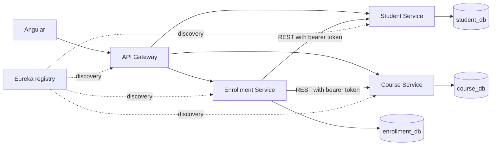

# Student Enrollment System

An academic application with three independently running Spring MVC services, an Angular UI, Spring Cloud Gateway and Eureka. The implementation targets **Java 17**, **Spring Boot 3.4.1**, **Spring Cloud 2024.0.1**, **Angular 21.2**, and **PostgreSQL 17**. Maven can also run on Java 21; Node 20.19+ or 22.12+ is required.

## Architecture



| Component | Local port | Responsibility |
| --- | --- | --- |
| Eureka | 8761 | Registers service instances so callers resolve service names rather than fixed ports |
| Gateway | 8080 | Routes /api/students and /api/auth to Student, /api/courses to Course, /api/enrollments to Enrollment; handles browser CORS |
| Student | 8081 | Academic profiles, separate login accounts, password checking and JWT issuance |
| Course | 8082 | Course catalogue, credits and CRUD |
| Enrollment | 8083 | Student/course references, capacity, duplicates, cancellation and deletion guards |
| Angular | 4200 | Existing dashboard, student/course management, enrollment and sign-in screens |

Each service uses Controller → Service → Repository → its own database. No service queries another service's database. Gateway routes use `lb://service-name`; synchronous `RestClient` builders use Spring Cloud LoadBalancer. Eureka therefore participates in both edge routing and internal calls. Gateway does not expose the internal reference-closing endpoints.

## Enrollment rules and request flow

1. Angular submits a CNIE and course ID to Gateway with a bearer token.
2. Gateway discovers Enrollment Service through Eureka and forwards the request.
3. `EnrollmentService.enrollStudent` checks ownership, resolves the student, and locks the student's reference followed by the course's reference.
4. It fetches the course through REST, rejecting missing resources with 404 and unavailable/invalid dependencies with 503.
5. In the same PostgreSQL transaction it rejects a duplicate or a course with **three** enrollments (409), then inserts the enrollment.
6. The transaction commits before returning 201. PostgreSQL releases the locks.

`EnrollmentReferenceRepository` creates missing reference rows with INSERT … ON CONFLICT DO NOTHING and loads them with JPA `@Lock(PESSIMISTIC_WRITE)`. The course row serializes capacity checks across service instances. A unique database index independently prevents duplicate student/course pairs. Transactions alone would not protect a count followed by an insert.

Cancellation deletes the enrollment, freeing its seat. It is allowed strictly **before** enrollment time + 24 hours; exactly 24 hours is rejected. Enrollment timestamps use UTC `Instant` and an injectable `Clock`. Cancellation locks the enrollment so a second cancellation returns 404. Administrators follow the same cancellation window.

## Deletion policy

Deleting a student or course first calls Enrollment Service to close that reference. In one Enrollment database transaction, it locks the same reference row used by enrollment creation, checks for active enrollments, and either rolls back with 409 or commits a permanent closed flag. Only then does the owner service delete its own record.

A concurrent enrollment either commits first (deletion gets 409) or sees the closed flag (enrollment gets 409). Both domain services require Enrollment Service to be reachable; failures return 503 and prevent local deletion. Student deletion removes its authentication account through a **local** foreign key; academic profiles and accounts are separate tables.

This is **not an atomic cross-service transaction**. A timeout after closing, a crash, or a local deletion failure can leave an existing profile/course closed for enrollment. Retry its DELETE as an administrator; closing is idempotent. References are never automatically reopened because an old deletion attempt could still complete. Do not reset IDs, restore only one database, bypass the APIs, or remove closed rows without reconciling all three databases.

## Authentication and authorization

Student Service stores BCrypt password hashes in `user_accounts`. On first startup it provisions one administrator from `ADMIN_USERNAME` and `ADMIN_PASSWORD` (12–72 characters). Subsequent starts do not reset that password.

An administrator creates an academic profile and then provisions a STUDENT login linked by student ID, through the Students screen or POST /api/auth/accounts. There is no public registration or role selection. CNIE is immutable through profile updates, preserving the account relationship.

POST /api/auth/login issues a **15-minute HS256 JWT** with issuer, audience, expiry, roles and linked student ID/CNIE. All three domain services independently validate its signature, issuer, audience and expiry using Spring Security OAuth2 Resource Server. Protected controller/service methods use `@PreAuthorize`; cancellation also checks the stored student ID. Internal REST calls forward the caller's token, so they do not impersonate administrators.

| Operation | ADMIN | STUDENT |
| --- | --- | --- |
| Browse courses | Yes | Yes |
| Create/update/delete profiles or courses | Yes | No |
| List all students | Yes | No |
| Read a student profile | Any | Own only |
| Provision student accounts | Yes | No |
| Create/list/cancel enrollments | Any, subject to business rules | Own only |
| Close deletion references | Yes | No |

Angular keeps tokens **in memory**, attaches them only to /api requests, and returns to sign-in on 401. Reloading the page requires signing in again. Server authorization is enforced even when calling a domain service directly.

The shared signing secret is a deliberate small-project trust boundary: all three services must be trusted, since possession of the HMAC secret permits token signing. Store it outside Git and use HTTPS outside localhost. Logout clears the browser token but does not revoke an already issued token. Account deletion/role changes do not instantly revoke tokens; authorization claims remain usable until expiry (plus Spring Security's default 60-second clock tolerance). There is no refresh token, password-reset flow, brute-force protection or user-role management UI. Eureka is private development infrastructure, not a public authenticated service.

## API overview

| API | Methods |
| --- | --- |
| /api/auth/login | POST {username, password} |
| /api/auth/accounts | POST {username, password, studentId}, administrator only; role is always STUDENT |
| /api/students | GET, POST {cnie, firstName, lastName, email} |
| /api/students/{id} | GET, PUT with the same profile fields, DELETE |
| /api/students/cnie/{cnie} | GET |
| /api/courses | GET, POST {title, description, credits} |
| /api/courses/{id} | GET, PUT with course fields, DELETE |
| /api/enrollments | POST {studentCnie, courseId} |
| /api/enrollments/student/{cnie} | GET |
| /api/enrollments/{id} | DELETE (within the cancellation window) |

Responses use 400 for invalid input, 401 for absent/invalid credentials, 403 for denied permissions, 404 for missing records, 409 for business/uniqueness conflicts and 503 for unavailable dependencies. Unexpected failures return generic 500 responses. Validation returns field messages; business errors return `{"error":"…"}`.

## Run with Docker Compose

From `student-enrollment-system`:

1. Copy `.env.example` to `.env` and replace every placeholder. Generate a random signing secret with at least 32 bytes.
2. Build the services: `mvn clean package -DskipTests`.
3. In `frontend/enrollment-app`, run `npm ci` and `npm run build`.
4. Return to the application directory and run `docker compose up --build`.
5. Open http://localhost:4200 and sign in with your bootstrap administrator. Eureka is at http://localhost:8761.

Compose runs **three separate PostgreSQL servers and persistent volumes**, one per owner. Domain ports stay inside the Compose network; only the UI, Gateway and Eureka bind to localhost. Allow roughly 30–90 seconds for Eureka registration/cache refresh before making requests. A startup-time 503 can be retried after registration completes.

## Run without Docker

Create `student_db`, `course_db` and `enrollment_db` in PostgreSQL. Give each service access only to its database. Export the following variables in each domain service's terminal (a .env file is loaded by Compose, not automatically by Java):

- `DB_URL`: optional; defaults to jdbc:postgresql://localhost:5432/<domain>_db.
- `DB_USERNAME`, `DB_PASSWORD`: required database credentials.
- `JWT_SECRET`: same random secret in all three domain services.
- `ADMIN_USERNAME`, `ADMIN_PASSWORD`: Student Service's initial administrator.
- `EUREKA_URL`: optional, defaults to http://localhost:8761/eureka/.
- `PORT`: optional per process, defaults to the table above.
- `HTTP_CONNECT_TIMEOUT` / `HTTP_READ_TIMEOUT`: default 2s / 5s.
- `FRONTEND_ORIGIN`: Gateway CORS origin, defaults to http://localhost:4200.

Build with `mvn package -DskipTests`, then start each JAR in a separate terminal:
`java -Xms64m -Xmx256m -jar <service>/target/<service>-0.0.1-SNAPSHOT.jar`.
Start Eureka first, the three domains next, then Gateway. In the frontend run `npm ci` then `npm start`. Its development proxy forwards /api to Gateway. For deployment the included Nginx configuration serves the production UI and proxies /api; the UI has no domain-service addresses.

For tests or explicit direct HTTP targets, set `clients.discovery.enabled=false` along with `student.service.url`, `course.service.url`, or `enrollment.service.url` as needed. The default remains discovery based.

## Database upgrades

Flyway owns schema changes; Hibernate validates instead of updating tables. V1 creates absent tables, adds local account/guard tables and required indexes, and preserves existing rows. Existing nonempty databases are baselined at version 0 so V1 still runs.

**Back up each database first.** Old enrollment LocalDateTime values have no recorded timezone. V1 interprets them as UTC; if the old installation used a different timezone, convert those values using the correct historical zone in a backed-up staging database **before** upgrading. No software can infer that missing timezone reliably.

Preexisting duplicate course titles, duplicate enrollments or null required profile fields cause migration to fail rather than silently delete data. Resolve those records explicitly before retrying. Old orphaned enrollments cannot be discovered with cross-database foreign keys; reconcile them through the owning APIs. Do not use Flyway clean on existing data.

## Tests

Fast HTTP-client tests run with `mvn test`. PostgreSQL API/security/concurrency tests are explicitly skipped unless `TEST_DATABASES=true` is set; a default green build does not imply database tests ran.

To run the full suite:

```powershell
docker compose -f compose.test.yml up -d --wait
./scripts/test.ps1
docker compose -f compose.test.yml down
```

The test database binds only to localhost:55432. Use a separate disposable database server, never your application data. Tests clear their service's test tables. Override `TEST_STUDENT_DB_URL`, `TEST_COURSE_DB_URL`, `TEST_ENROLLMENT_DB_URL`, `TEST_DB_USERNAME` and `TEST_DB_PASSWORD` if needed. On other shells, set those variables, run `mvn clean verify`, then `npm ci`, `npm test -- --watch=false` and `npm run build` in the frontend.

Tests cover actual PostgreSQL migrations/constraints, overlapping last-seat requests, enrollment versus deletion, cancellation boundaries, real signed JWT validation, direct-service permissions, CRUD, invalid inputs, downstream errors and the Angular authentication interceptor. Remote clients are mocked only in the domain database tests; see `docs/verification.md` for live discovery and browser checks.

GitHub Actions runs the PostgreSQL suite and Angular checks on Java 17 / Node 22. The local verification record distinguishes checks actually executed from configuration supplied but not executed.

## Study guide

See [the interview guide](docs/interview-guide.md) for class/method references, [the audit](docs/audit.md) for verified original problems, and [verification](docs/verification.md) for executed checks and remaining limitations.

Further reading: [Spring Security JWT resource servers](https://docs.spring.io/spring-security/reference/servlet/oauth2/resource-server/jwt.html) and [Spring Cloud LoadBalancer](https://docs.spring.io/spring-cloud-commons/reference/spring-cloud-commons/loadbalancer.html).

See [the simplification guide](docs/simplification-guide.md) for the JPA locking workflow and before/after examples.
